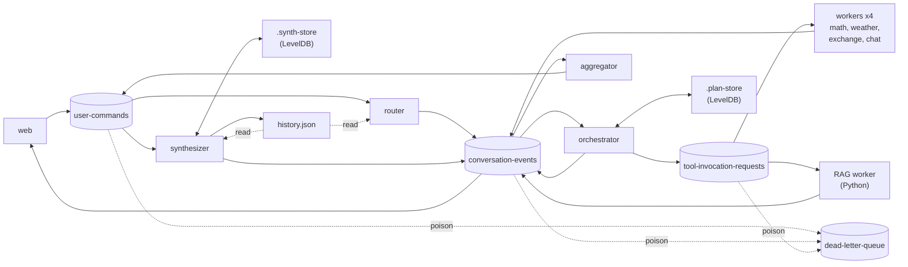

# Kafka Agent Orchestrator

[](https://github.com/arelraba11/kafka-agent-orchestrator/actions/workflows/ci.yml)
[](LICENSE)

A multi-step LLM agent in which 10 services coordinate only through Kafka. The router plans tool calls, an orchestrator runs them one step at a time, a Python RAG worker answers product questions, and a synthesizer writes the answer.
Stack: Bun + TypeScript, kafkajs, zod, LevelDB, Python 3.12 + ChromaDB, React 19 + Vite.

- Plan state transitions are effectively-once under at-least-once delivery.
- zod contracts are enforced in both TypeScript and Python.
- Poison messages cannot block a partition.
- Every failure reaches the user, as an error event or, for a message with no conversation (for example malformed JSON), as the client's 90 s idle timeout.

**41 integration scenarios run against a real Kafka broker, and the crash scenarios kill real service processes at named crash points. They check that no step is lost, no result is applied twice and no history entry is duplicated. CI runs them in about 5 minutes (warm caches) with no API key.**

## Demo

<!-- demo GIF: docs/demo.gif, recorded manually -->

Three flows, with the events each one produces. Step-by-step reproductions are in [`docs/resilience-demo.md`](docs/resilience-demo.md).

**(a) Two steps with data flow.** `how much is an iPhone in ILS?`

`UserQueryReceived` → `PlanGenerated [getProductInformation, exchange]` → the RAG worker returns `{context, value:"1199"}` → `exchange` receives `currencyCode:"USD"`, `targetCurrency:"ILS"`, `amount:"{{step_0.result}}"` resolved to `1199` → `PlanCompleted` → `FinalAnswerSynthesized`, for example "The price of an iPhone is 1199 USD, which is approximately 4436.3 ILS." (the wording varies between runs).

`value` is the knowledge-base price in USD ([`src/python/rag/price.py`](src/python/rag/price.py)). `{{step_N.result}}` resolves to `value`, then `context`, then JSON, so `exchange` converts 1199 and not the first number in the context text (`16`, from "iPhone 16 Pro Max"). This phrasing is one of the router's few-shot examples ([`shared/prompts/routerPlanPrompt.ts`](shared/prompts/routerPlanPrompt.ts)); the regex fallback never plans this chain. With `LLM_PROVIDER=openai` the router planned it in 5 of 5 consecutive runs. Evidence: R0 in `test/integration/rag.test.ts`.

**(b) Tool error.** `PlanGenerated [math "2/0"]` → `ToolInvocationResulted{error:"Division by zero"}` → `PlanFailed{code:"tool-error", failedTool:"math"}`. Nothing is dead-lettered; a failed plan is an event. The scenario is shown with an injected plan, because the LLM router answers a typed "what is 2/0" as `chat`. Commands: Scenario 5 in [`docs/resilience-demo.md`](docs/resilience-demo.md). Evidence: the "failed step" cases in `src/node/orchestration/planTransition.test.ts`.

**(c) Step timeout.** A worker is down → no result → `StepTimedOut` after `STEP_TIMEOUT_MS` (30 s) → `PlanFailed{code:"step-timeout"}` → the UI shows "The math tool didn't respond within 30 s." A result that arrives later is ignored. Evidence: T1 and T2 in `test/integration/timeouts.test.ts`.

## Quick start

Prerequisites: Docker with Compose v2, Bun 1.3.3 (`.bun-version`), Python 3.12, and an LLM.

- **Recommended:** an OpenAI key, with `LLM_PROVIDER=openai`.
- **Keyless:** Ollama, started by compose, used by `LLM_PROVIDER=ollama` or `auto` (the code default: one Ollama attempt, then OpenAI). The default model `llama3.2:1b` plans multi-step queries poorly, so use OpenAI to see the demo flows.

```bash
cp .env.example .env            # then set LLM_PROVIDER=openai and OPENAI_API_KEY
docker compose -f infra/docker-compose.yml up -d kafka   # add `ollama` to also start Ollama
bun install

python3.12 -m venv src/python/venv
src/python/venv/bin/pip install -r src/python/rag/requirements.txt
src/python/venv/bin/python src/python/rag/index_kb.py    # builds the ChromaDB index (56 chunks)

bun run start     # topics, UI build if needed, then all 10 services under a supervisor
# open http://localhost:3001, or send a plain-text frame to ws://localhost:3001/ws
bun run stop      # stops the supervisor and only this repo's pids from .run/
```

Service logs are in `scripts/logs/services/`. `bun run start` creates the topics, pulls the Ollama model only for `auto`/`ollama`, builds the UI when `src/frontend/dist` is missing or stale, and restarts crashed services with backoff.

To run the tests with no LLM and no key: `bun run test` (unit) and `bun run test:int` (see [Testing](#testing)).

## Architecture



1. `web` receives a WebSocket frame and publishes `UserQueryReceived` to `user-commands`.
2. `router` asks the LLM for a plan (an ordered list of `{tool, args}`), falls back to a regex planner if the LLM fails, and publishes `PlanGenerated`.
3. `orchestrator` stores the plan in LevelDB and dispatches one step at a time as `ToolInvocationRequested`. Later steps can use earlier results through `{{step_N.result}}`.
4. A worker picks up its tool's requests and publishes `ToolInvocationResulted`. A step that nobody answers times out as `StepTimedOut`.
5. When the last step is done the orchestrator emits `PlanCompleted`; a failed step or a timeout emits `PlanFailed`.
6. `aggregator` turns `PlanCompleted` into `SynthesizeFinalAnswerRequested`.
7. `synthesizer` calls the LLM and publishes `FinalAnswerSynthesized`, or `ConversationFailed` if it cannot. `web` forwards the final events to the socket.

Every message is keyed by `conversationId`, so each conversation lives on one partition per topic. The dead-letter queue takes poison messages from any consumer on any of the three topics (the dashed edges). Event shapes, per-service details and configuration: [`docs/architecture.md`](docs/architecture.md).

**RAG worker.** The sample knowledge base is 11 products in `data/products/` (56 chunks). For each request the worker:

1. retrieves the top-K chunks by embedding similarity;
2. picks the top source by product name (`prefer_product_match` → `select_top_source` in [`source_match.py`](src/python/rag/source_match.py)). A source matches when every token of its file stem (`galaxy_s25_ultra` → galaxy, s25, ultra) appears as a whole word in the query. The most specific match wins, ties go by embedding rank, and with no match the embedding order stands. `Galaxy S25 price` therefore reads `galaxy_s25`, not the closer-scoring `galaxy_s25_ultra`;
3. applies the price rule ([`price.py`](src/python/rag/price.py)) to that source and returns the price as `result.value` and the retrieved text as `result.context`.

Evidence: `test_source_match.py`, `test_price.py` (every KB product), R0.

**Currency rule.** Every KB price is USD. The router prompt converts a KB price only with `currencyCode: "USD"` ([`routerPlanPrompt.ts`](shared/prompts/routerPlanPrompt.ts)), and the synthesis prompt treats a product-tool price as USD even when it is a bare number ([`synthesisPrompt.ts`](shared/prompts/synthesisPrompt.ts)). A new KB file with a non-USD price would break both, so new files must quote USD.

## Delivery guarantees

Delivery is at-least-once and handlers are idempotent, which makes plan transitions effectively-once. Outbound events can be duplicated, and consumers absorb the duplicates: the orchestrator by `stepIndex`, the synthesizer by its `done:` marker, the history file by `conversationId`.

The orchestrator emits, then persists, then lets kafkajs commit the offset. That order is safe because of this invariant, quoted from [`orchestrator.ts`](src/node/orchestration/orchestrator.ts):

> INVARIANT: emit-before-persist is correct only because every event for a conversation is keyed by conversationId (→ one partition of conversation-events) and kafkajs handles a partition serially (partitionsConsumedConcurrently = 1). A redelivered message is therefore always re-handled before any later event for the same conversation, against the same persisted state. Do not raise concurrency per partition, or key these events by anything else, without revisiting this.

It also relies on a single orchestrator, since the LevelDB store is locked by one process. Sharing state across orchestrators breaks it too.

The "Before" column describes the original design of each window; "After" is what the code does now.

| Window | Before | After | Evidence |
|---|---|---|---|
| Orchestrator: state written, next step not emitted | A redelivered result is re-applied, a step is skipped, the answer is wrong | Cannot occur: emit precedes persist | `orchestrator.ts` ordering, crash-replay cases in `planTransition.test.ts` |
| Orchestrator: emitted, not persisted (start / advance / complete) | A `PlanGenerated` replay resets the plan; a second `PlanCompleted` | The same transition is recomputed and re-emitted; the duplicate result is ignored | C-b1, C-b2, C-b3 |
| Orchestrator: persisted, offset not committed | Results re-applied, full re-run | Every replay is ignored (`duplicate-step`, `plan-terminal`, `duplicate-plan`) | C-c1, C-c2, C-c3 |
| Duplicate result while the plan is live | `stepIndex` advanced twice | Ignored | D1 |
| Duplicate result after completion; duplicate `PlanGenerated` | Re-applied; plan reset | Ignored | D2, D3 |
| Duplicate `PlanCompleted` | Two LLM calls, two history entries | One LLM call, one entry | D4 |
| Synthesizer crash after the LLM call, before the memo | Question lost on restart | LLM asked again once; the question was persisted | S1 |
| … after the memo, before the publish | | Published from the memo, no LLM call | S2 |
| … after the publish, before `done` | Duplicate answer and history entry | Republished; history still has one entry | S3 |
| … after history, before `done` | | History append is idempotent | S4 |
| Broker down while emitting | Error swallowed or plan failed | Retried and redelivered, never dead-lettered | X1 |
| Orchestrator killed with a step pending | The plan waits forever | Timer re-armed at the original deadline (fires once the restarted orchestrator owns the partition again) | T3 |
| RAG producer cannot reach the broker (cold producer) | Silent; offset auto-committed, result lost | Exits uncommitted, redelivered after restart | R1a |
| RAG send never acknowledged (warm producer) | Silent; offset auto-committed, result lost | No commit without the ack, redelivered. Catches a bare `send()` without `.get()`, which R1a cannot | R1b |
| RAG crash after the send, before the commit | Duplicate result re-applied | Duplicate ignored | R2 |
| Store I/O error | Read as "unknown", write swallowed | Retryable, redelivered | `shared/kafka/consume.test.ts` (unit) |
| Machine crash right after a state write | Unsynced write lost | Writes use `sync: true` | Design only, not tested |

C-*, D*, S*, X1, T*, R* are test IDs in `test/integration/`: `crash-orchestrator`, `idempotency`, `crash-synthesizer`, `retryable`, `timeouts` and `rag`. Find one with `grep -F "C-b1:" test/integration/*.test.ts`.

## Failure handling

Failures with no plan state are `ConversationFailed` events (`stage`: routing, orchestration, aggregation, synthesis). Failed plans are `PlanFailed` events (`code`: tool-error, step-timeout, empty-plan). The web server maps both to one error frame (`toClientFrame` in [`clientFrames.ts`](src/node/core/clientFrames.ts)), and the UI shows its `reason`.

| Failure | What happens | What the user sees | Evidence |
|---|---|---|---|
| Router LLM fails or returns an invalid plan | Regex planner; `[router] mode=regex-fallback` | A normal answer | L7 |
| Synthesizer LLM: timeout, network, 429, 5xx | Bounded retries in `callLLM`, then `ConversationFailed{code:"llm-unavailable"}` | "The language model is unavailable right now. Try again." | L1, L2, L5, L6 |
| Synthesizer LLM: 401/403, bad config | Not retried, `llm-misconfigured` | "The assistant's language model is misconfigured. Check the server logs." | L3 |
| Synthesizer LLM: blank answer | Retried, then `empty-answer` | "The language model returned an empty answer. Try again." | L4 |
| Tool returns `{error}` | `PlanFailed{code:"tool-error"}` | "The `<tool>` tool failed: `<its error>`" | `planTransition.test.ts` |
| Step nobody answers | `StepTimedOut` → `PlanFailed{code:"step-timeout"}` | "The `<tool>` tool didn't respond within 30 s." | T1, T2, T3 |
| Poison message that belongs to a conversation | DLQ record, then the owning service emits `ConversationFailed{code:"internal-error"}` | "Something went wrong while … (ref `<id8>`)" | P4, PO1 |
| Broker or store I/O error in a handler | `RetryableError`; redelivered, never dead-lettered | Delay only | X1 |
| Web server cannot publish the query | `error{code:"unavailable"}` | "The service is unavailable right now. Try again." | `clientFrames.test.ts` |
| A service process crashes | The supervisor restarts it; Kafka redelivers what was not committed | Nothing, or a step timeout | SV1 |
| Nothing answers for 90 s | The UI fails the request | "No response after 90 s. The request may still finish; try again." | `inFlight.test.ts` |
| WebSocket closes while waiting | The UI fails the request | "Connection lost while waiting for the answer." | `inFlight.test.ts` |
| `history.json` corrupt | The writer quarantines it to `history.json.corrupt-<ts>`; readers log ERROR and use no history | Answers keep arriving | `shared/state/historyStore.test.ts` |

`L1`–`L7` are the test IDs in `test/integration/llm-failures.test.ts`. The LLM policy: every attempt has a timeout, transient errors are retried only inside `callLLM`, and the router gets 15 s and 1 attempt while the synthesizer gets 60 s and 3. `LlmError` is non-retryable for Kafka, and every caller catches it.

## Contracts

- Each message type has one zod schema in `shared/schemas/`; there are 11. `bun run schemas:gen` produces JSON Schema (draft 2020-12; readers are tolerant of extra fields). `bun run schemas:check` and `generated.test.ts` fail when the generated files drift.
- The Python worker validates against the generated JSON Schema with `jsonschema`. Fixtures in `shared/schemas/__fixtures__/` run through both zod (`bun run test`) and `jsonschema` (`bun run test:py`), so both languages accept and reject the same messages.
- Producers validate before sending (`publish()`); consumers validate in `subscribeAndRun`.

**Dead-letter queue.** It holds poison messages only, as `MessageDeadLettered` records.

- Classes: `malformed-json`, `missing-value`, `contract-violation`, `outbound-contract-violation`, `key-mismatch`, `handler-non-retryable`, `unknown-exhausted`.
- Each interested consumer group writes its own record, then commits the offset, so the partition keeps flowing. There is no replay tool.
- One owner tells the user ([`failureOwnership.ts`](shared/kafka/failureOwnership.ts), pinned by `failureOwnership.test.ts`): the router owns `UserQueryReceived`, the orchestrator `PlanGenerated`, the aggregator `PlanCompleted`, the synthesizer `SynthesizeFinalAnswerRequested`. The web server sends a direct error frame for a poison final event.
- The orchestrator reports a poison `PlanGenerated` only when no plan exists for the conversation: PO1 is reported once as an orchestration failure; PO2 is dead-lettered but not reported.

Evidence: P1–P4, PO1, PO2, P-flow, E1, E2 (`poison`, `idempotency` and `rag` tests), `shared/schemas/schemas.test.ts`, `failureOwnership.test.ts`, `src/python/rag/test_contracts.py`.

## Design decisions

| Decision | Gain | Cost |
|---|---|---|
| Kafka is the only channel between services | Full decoupling and an audit trail | Harder debugging; correlate by `conversationId` |
| Key by `conversationId` | Per-conversation ordering with no locks | No parallelism inside a conversation; a hot conversation pins a partition |
| Emit → persist → commit, no outbox or transactions | Simple; input redelivery is the recovery loop | Downstream events can be duplicated |
| Pure `transition(state, event, now, config)` | Crash windows are unit-testable without Kafka | The shell has to keep its ordering |
| Terminal plans kept as tombstones | Late or replayed events are recognizable | Unbounded growth |
| zod → generated JSON Schema, tolerant reader | One source of truth for two languages; additive fields are safe | No broker-side compatibility enforcement |
| Poison-only DLQ; business failures are events | A dead letter means "incident" | Duplicate records per consumer group |
| Retryable vs non-retryable errors; unknown errors get 3 attempts | Blips are absorbed; deterministic bugs unblock the partition | The attempt count resets on restart |
| Step timeouts as events on the conversation's partition | Result-vs-timeout race is decided by log order | Timers live in the orchestrator process |
| LLM retries in one layer, with per-call budgets | Bounded latency | A slow provider fails a request instead of making it wait |
| Synthesizer: publish → persist with a memoized outcome | No lost notification, at most one extra LLM call | A second LevelDB store |
| Fault points in service code; compose test broker | Deterministic crash tests on a real broker, locally and in CI | Env-gated no-op calls ship in production code. testcontainers was not used: in a spike, `start()` never resolved under Bun 1.3.3 |
| LevelDB, not a Kafka Streams state store | Works in Bun | State is not partition-owned (see [At scale](#what-id-do-at-scale)) |

## Testing

| Suite | Command | Proves | Needs | Runtime |
|---|---|---|---|---|
| Unit | `bun run test` | Transitions, error classification, DLQ records, contracts, LLM policy, synthesizer ordering, history, timers | Bun | 394 tests, under 1 s |
| Python | `bun run test:py` | Fixture parity with zod, decode/validate/DLQ, price rule, source matching, Kafka config, fault points | The venv | 89 tests, under 1 s |
| Integration | `bun run test:int` | The guarantees and failure tables above, on a real broker with real processes and a fake LLM | Docker, the venv, `index_kb.py` | 52 tests (41 scenarios + 11 harness self-tests), about 170 s locally; CI about 5 min warm, 6 min cold |

Always `bun run test`, never bare `bun test`, which would also collect `test/integration`. CI runs typecheck, `schemas:check`, the unit and Python suites, the frontend build and the integration suite on every pull request and every push to `main`. It uses no retries, and a nightly job runs the integration suite three times to catch flakes.

No API key is needed: the router and synthesizer talk to a fake OpenAI-compatible server, services run with `--no-env-file`, and the preload aborts if it sees a real key.

**Consumer timing rule.** `KAFKA_MAX_WAIT_MS` (the fetch long-poll) must stay well below `KAFKA_SESSION_TIMEOUT_MS`, because kafkajs sends heartbeats between fetches. A longer wait lets an idle member's session expire, and the rebalance redelivers in-flight messages. The suite uses 500 ms with a 3000 ms session.

**Test knobs.**

- `KEEP_BROKER=1` keeps the broker between runs; `bun run test:int -t "<pattern>"` filters by test name; `TEST_KAFKA_PORT` and `PYTHON_BIN` override the broker port and the interpreter.
- `KAFKA_MAX_BLOCK_MS`: `rag.test.ts` sets 3000 so a cold RAG producer gives up fast.
- Fault points: `FAULT_DIR` enables them; `FAULT_CRASH` and `FAULT_HOLD` take `<point>[@<decision>]`. The `#<n>` selector (n-th call) exists only in the Python twin, [`fault_point.py`](src/python/rag/fault_point.py).
- `HF_HOME` and `HF_HUB_OFFLINE` are the CI offline-model knobs.

## Known limitations

**Scale and state**

- One instance per service. The orchestrator is single by design (LevelDB lock plus the partition invariant). Each service handles one message at a time, so the 3 partitions give ordering, not throughput.
- Plan tombstones and `.synth-store/` `done:` keys grow forever; nothing prunes them.
- Step timers live in the orchestrator. While it is down, no timeout fires. On restart they are re-armed at the original deadline, but an overdue timeout is applied only once the restarted orchestrator owns the partition again. After a crash that waits for the dead member's session to expire, about 30 s with the defaults (`KAFKA_SESSION_TIMEOUT_MS`), so a pending step can time out that much late.
- State is local files. `history.json` has a single writer (the synthesizer). `PlanState` in LevelDB is not schema-validated; history is.
- Kafka keeps its default 7-day retention. State lives in LevelDB and is not rebuilt from the log.
- Steps run sequentially; independent steps are not parallelized.

**Delivery**

- Downstream events are at-least-once. A crash window can deliver a duplicate answer frame; the UI shows the first.
- The router is not idempotent. A `UserQueryReceived` redelivered after a rebalance is planned again, which costs a second LLM call. The orchestrator ignores the resulting duplicate `PlanGenerated` (`duplicate-plan`, D3), so the user still gets one answer.
- Retry budgets. The TypeScript unknown-error budget (3 attempts) resets when a process restarts. The Python worker has no bounded retry for unknown errors; a restart is its only redelivery.

**Operations**

- The supervisor is dev-grade: local processes with restart backoff, giving up after 5 crashes in 2 minutes. It is not a production process manager.
- The client idle timeout is fixed at 90 s.

**RAG and data**

- Retrieval and pricing:
  - Product-name matching only reorders the sources retrieval returned; a product outside the top-K is never selected.
  - Name tokens must appear as whole words, so `galaxy` alone, or `PS5` against the stem token `ps5` when the query says "PS 5", can miss.
  - After the reorder, chunks are no longer in pure score order.
  - The price rule takes the first price line in the top source, so an add-on line (MacBook AppleCare `$299`, Tesla FSD `$8,000`) wins if its chunk ranks above the headline chunk. With no price at all there is no `value`, and `exchange` parses the first number in the context text.
- The RAG worker hardcodes the logical topic names. With the default `KAFKA_MAX_BLOCK_MS` (60000), a cold producer, one that has not sent yet, blocks up to 60 s on a down broker before it exits.
- Weather and FX data are stubbed. The regex fallback planner has no keyword for iPad, Honda or any of the 6 newer products (Galaxy S25, Galaxy S25 Ultra, Sony WH-1000XM5, PlayStation 5 Pro, Nintendo Switch 2, Toyota Camry). A query naming one reaches RAG through the fallback only via a generic word such as "phone" or "laptop".

**Testing**

- What the integration suite does not exercise. Tests run on fresh namespaces with `KAFKA_OFFSET_RESET=earliest`; production uses `latest`, so a message produced before a brand-new group's first join is skipped, and that reset is not integration-tested. Only the OpenAI-compatible LLM path is integration-tested; Ollama is unit-tested.
- Fault points live in service code. They are no-ops unless `FAULT_DIR` is set.

## What I'd do at scale

- Schema Registry with Avro or Protobuf and compatibility rules enforced at produce time, in place of generated-JSON-Schema discipline.
- Partition-owned state: Kafka Streams-style state stores with changelog topics, or per-partition stores handed over on rebalance. That allows several orchestrators and removes the single-instance and retention limits.
- A compacted topic or a TTL for tombstones and dedupe keys.
- A transactional outbox (or Kafka transactions) where state moves to a shared database or a handler has non-idempotent side effects. Here input redelivery plus idempotent transitions already give the same guarantee, so this is a condition, not a gap.
- Kubernetes Deployments with restart policies and liveness probes instead of the local supervisor.
- A DLQ replay tool, alerting on DLQ rate and consumer lag, and OpenTelemetry traces keyed by `conversationId`.
- Parallel dispatch for independent steps (a DAG plan).

## Docs

- [`docs/architecture.md`](docs/architecture.md): event catalog, per-service details, state stores, infrastructure, repository layout.
- [`docs/resilience-demo.md`](docs/resilience-demo.md): manual scenarios you can run yourself, each with its evidence.
- [`.env.example`](.env.example): every runtime environment variable, with defaults.

## License

[MIT](LICENSE)
